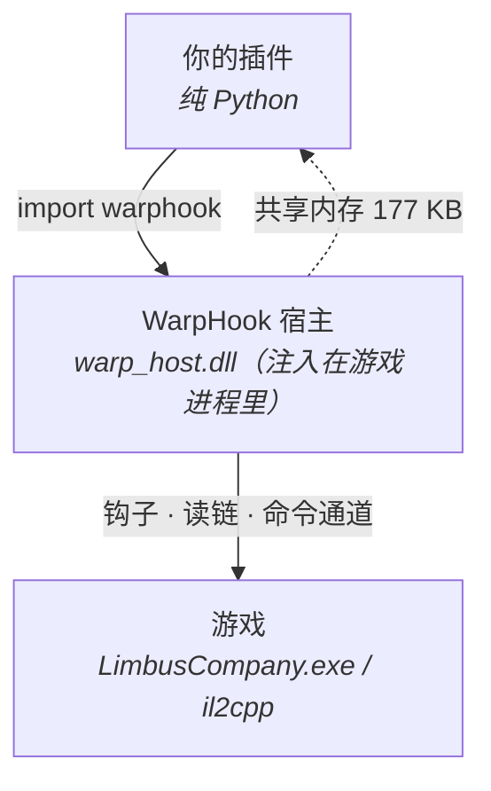

# FaustLauncher 插件开发文档

这是 FaustLauncher 的插件开发文档。目标很具体：**让你能写出一个真正跑起来的插件**——从打印一行日志，到拦下一抽卡、读出场上每个单位的血量与身上的 buff。

## 你会学到什么

| 想做的事 | 去哪看 |
| --- | --- |
| 我完全不懂，先跑个空插件 | [第一个插件](tutorial/01-hello.md) |
| 让游戏弹一句话 | [弹窗](tutorial/02-popup.md) |
| 回合开始 / 切场景时自动干活 | [事情发生时通知我](tutorial/03-events.md) |
| 读单位的血量、理智、速度、人格 ID | [读一个单位](tutorial/04-unit.md) |
| 拿到一个单位身上六十多个字段 | [把属性都拿出来](tutorial/05-props.md) |
| 解析 buff 的层数、回合、英文 ID | [解析 buff](tutorial/06-buffs.md) |
| 插件怎么收尾、什么不能做 | [生命周期与线程](tutorial/07-lifecycle.md) |
| 想拦下游戏的动作、自己写钩子 | [想到底层去](tutorial/08-inside.md) |
| 查某个函数 / 常量的完整签名 | [技术文档](technical/index.md) |

## 三层结构，从头到尾都能用

写插件时你只碰最上面一层：纯 Python，不写一行 C，不带自己的 DLL。

## 两条阅读路线

| 你是 | 怎么读 |
| --- | --- |
| 想尽快写出能用的插件 | 从 [第一个插件](tutorial/01-hello.md) 顺序读到 08 |
| 已经在写，要查某个接口 | 直接翻 [技术文档](technical/index.md)，按命名空间分页 |

技术文档是**接口字典**：`warp.game` / `warp.object` / `warp.field` / `warp.plugin` 逐页罗列
全部函数、常量、参数与示例；入门教程是**顺序故事**，两边不重复。

## 前提

- Windows，游戏能正常启动
- 插件放在 `addons/<你的插件名>/` 下，至少两个文件：`addon_info.json` 和 `scr.py`
- 依赖 `WarpHook`（在 `addon_info.json` 的 `requires` 里写上，启动器会自动排好加载顺序）

## 版本

本文档对应 WarpHook `0.9.9`（协议 v7）。协议号变了，偏移和读链写法可能一起变——看 `addons/WarpHook/CHANGELOG.md`。
