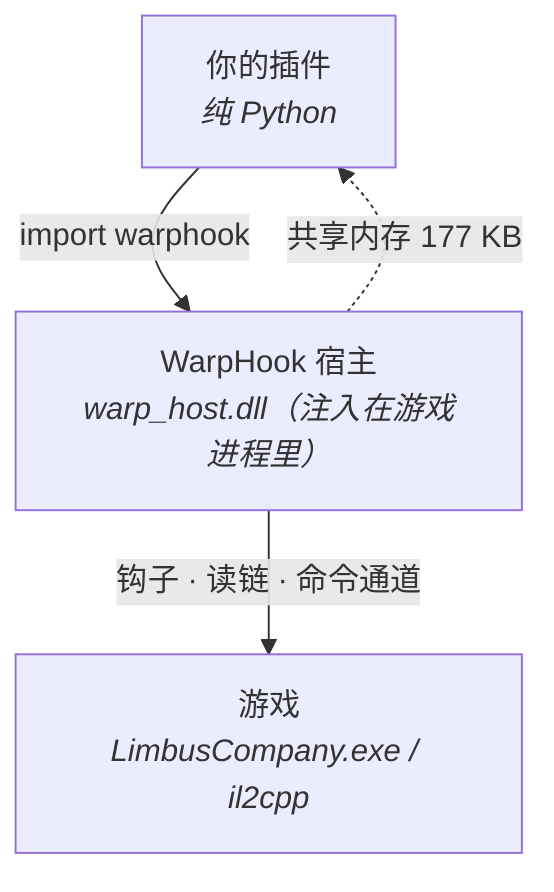

  

    ● FaustLauncher 官方插件开发套件
  

  <h1 class="moyuu-hero-title">基于 WarpHook 的插件二次开发</h1>
  

    从零起步构建专业游戏插件：深入 il2cpp 运行时，从拦截抽卡事件到实时读取全场单位数据、状态与 Buff 链。纯 Python 开发，无需编写 C 代码。
  

  

    <a href="tutorial/01-hello.md" class="moyuu-btn moyuu-btn-primary">
      🚀 快速起步教程
    </a>
    <a href="technical/index.md" class="moyuu-btn moyuu-btn-secondary">
      📖 API 接口字典
    </a>
    <a href="https://github.com/f0lkskill/FaustLauncher" target="_blank" class="moyuu-btn moyuu-btn-secondary">
      GitHub 源码仓库
    </a>
  

  <a href="tutorial/01-hello.md" class="moyuu-card">
    
⚡

    
快速入门教程

    
循序渐进掌握插件生命周期：从跑通空插件、弹窗测试到 Hook 监听与单位属性获取。

    
开始学习 →

  </a>
  <a href="technical/index.md" class="moyuu-card">
    
📚

    
技术架构与 API

    
详尽的命名空间字典：warp.game, warp.object, warp.field, warp.plugin 签名及规范。

    
查看文档 →

  </a>
  <a href="reference/game-memory.md" class="moyuu-card">
    
🧩

    
内存与偏移参考

    
游戏底层数据结构透视，深入掌握单位指针、Buff 结构与内存读链偏移量。

    
探索参考 →

  </a>

## 你会学到什么

| 想做的事 | 去哪看 |
| --- | --- |
| 我完全不懂，先跑个空插件 | [第一个插件](tutorial/01-hello.md) |
| 让游戏弹一句话 | [弹窗](tutorial/02-popup.md) |
| 回合开始 / 切场景时自动干活 | [事情发生时通知我](tutorial/03-events.md) |
| 读单位的血量、理智、速度、人格 ID | [读一个单位](tutorial/04-unit.md) |
| 拿到一个单位身上六十多个字段 | [把属性都拿出来](tutorial/05-props.md) |
| 解析 buff 的层数、回合、英文 ID | [解析 buff](tutorial/06-buffs.md) |
| 插件怎么收尾、什么不能做 | [生命周期与线程](tutorial/08-lifecycle.md) |
| 想换战斗里的 BGM | [放一首 BGM](tutorial/07-bgm.md) |
| 想拦下游戏的动作、自己写钩子 | [想到底层去](tutorial/09-inside.md) |
| 查某个函数 / 常量的完整签名 | [技术文档](technical/index.md) |

## 三层结构，从头到尾都能用

写插件时你只碰最上面一层：纯 Python，不写一行 C，不带自己的 DLL。

## 两条阅读路线

| 你是 | 怎么读 |
| --- | --- |
| 想尽快写出能用的插件 | 从 [第一个插件](tutorial/01-hello.md) 顺序读到 08 |
| 已经在写，要查某个接口 | 直接翻 [技术文档](technical/index.md)，按命名空间分页 |

技术文档是**接口字典**：`warp.game` / `warp.object` / `warp.field` / `warp.plugin` 逐页罗列
全部函数、常量、参数与示例；入门教程是**顺序故事**，两边不重复。

## 前提

- Windows，游戏能正常启动
- 插件放在 `addons/<你的插件名>/` 下，至少两个文件：`addon_info.json` 和 `scr.py`
- 依赖 `WarpHook`（在 `addon_info.json` 的 `requires` 里写上，启动器会自动排好加载顺序）

## 版本

本文档对应 WarpHook `0.9.39`（协议 v11）。协议号变了，偏移和读链写法可能一起变——看 `addons/WarpHook/CHANGELOG.md`。

## 出问题时先看哪

整个 WarpHook 只有**一个**日志文件：`addons/WarpHook/warp.log`。宿主 DLL（游戏进程内）和
Python 侧写的是同一个文件，靠行首的通道标签区分：

| 标签 | 谁写的 | 里面是什么 |
| --- | --- | --- |
| `[host]` | 宿主 DLL + 启动器侧 Python | 注入、装配、`configure`、钩子安装、命令通道、`warp.pygame` 调用 |
| `[event]` | 事件流水 | 每次钩子命中：时间、槽号、返回值、动作 |

启动器每次运行会**覆写**这个文件（不是追加、不轮转、不留 `.1` 备份），所以它永远只描述
「当前这一轮」。要留档就在启动器退出后自己拷走。判读方法见
[入门 01](tutorial/01-hello.md#log-file)。
