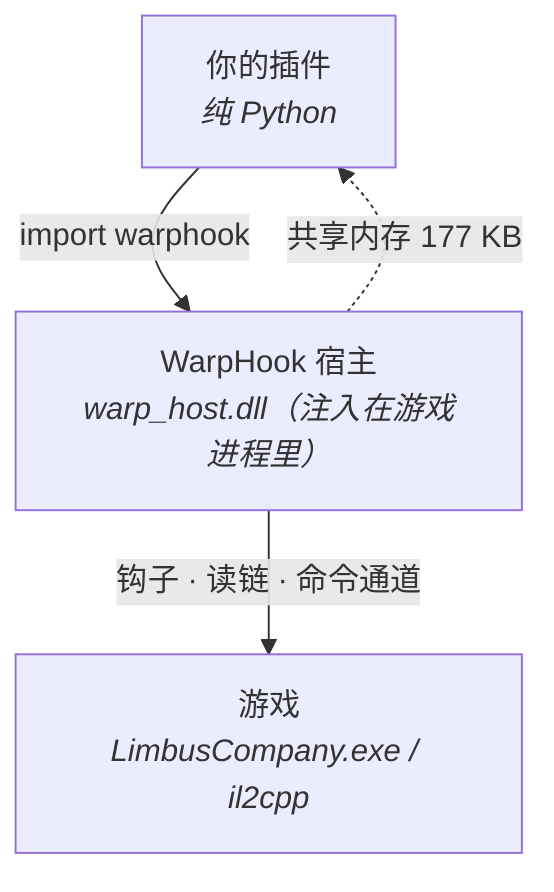

  <!-- Moyuu 风格概览引导卡片 -->
  

    

      ● FaustLauncher 官方插件开发套件
    

    <h1 class="moyuu-hero-title">基于 WarpHook 的插件二次开发</h1>
    

      几分钟内上手游戏底层插件开发：基于共享内存与 il2cpp 运行时，从拦截抽卡动作到实时读取全场单位数据、属性与 Buff 状态。纯 Python 编写，无需配置 C/C++ 编译器。
    

    

      <a href="tutorial/01-hello.md" class="moyuu-btn moyuu-btn-primary">
        🚀 快速起步教程
      </a>
      <a href="technical/index.md" class="moyuu-btn moyuu-btn-secondary">
        📖 API 接口字典
      </a>
      <a href="https://github.com/f0lkskill/FaustLauncher" target="_blank" class="moyuu-btn moyuu-btn-secondary">
        GitHub 源码仓库
      </a>
    

    <!-- 步骤引导卡片行（仿照 Moyuu 引导 1. 2. 3.） -->
    

      <a href="tutorial/01-hello.md" class="moyuu-step-item">
        

          
1. 创建首个插件

          
编写 addon_info 与 scr.py 跑通空插件

        

        
→

      </a>
      <a href="tutorial/03-events.md" class="moyuu-step-item">
        

          
2. 订阅游戏事件

          
监听回合开始与切场景，自动执行逻辑

        

        
→

      </a>
      <a href="tutorial/04-unit.md" class="moyuu-step-item">
        

          
3. 读取全场对象

          
获取单位血量、理智、速度与 Buff 层数

        

        
→

      </a>
    

  

  <!-- 首个插件示例卡片（仿照 Moyuu 首个 API 请求预览卡片） -->
  

    

      

        ⚡ 插件代码示例
        Python 3.10+
      

      

        ● 内存映射在线
        🔒 共享内存 177 KB
      

    

    

# addons/my_plugin/scr.py
import warp.game as game
import warp.object as obj

def on_round_start(round_num):
    units = obj.get_battle_units()
    for u in units:
        print(f"[Round {round_num}] 单位 {u.name}: HP={u.hp}/{u.max_hp}, SP={u.mp}")
    game.popup_message("回合数据分析完毕")
    

    

      协议版本: v11 (WarpHook 0.9.39)
      运行环境: Windows x64 (il2cpp)
    

  

  <!-- 数据看板指标卡片（仿照 Moyuu 用量概览 4 栏卡片） -->
  

    

      

        命名空间支持
        📚
      

      
5 个

      
game / object / field / plugin / audio

    

    

      

        单位属性字段
        🔍
      

      
60+

      
包含基础数值、部位判定与 Buff 链表

    

    

      

        IPC 共享内存
        ⚡
      

      
177 KB

      
低延迟双向环形缓冲区，微秒级同步

    

    

      

        底层钩子通道
        🛡️
      

      
零 DLL

      
统一托管 warp_host 宿主，纯 Python 编写

    

  

  <!-- 推荐操作卡片（仿照 Moyuu 模块卡片） -->
  

    <a href="tutorial/01-hello.md" class="moyuu-feature-card">
      
🚀

      
入门教程体系

      
9 个实战小节循序渐进，从空插件、弹窗、事件监听、数据读取直到音乐替换与底层钩子。

      
开始学习 →

    </a>
    <a href="technical/index.md" class="moyuu-feature-card">
      
📖

      
技术接口字典

      
分命名空间详细查阅所有 API 的函数签名、参数类型、返回值、使用约定及经典示例。

      
查阅接口 →

    </a>
    <a href="reference/game-memory.md" class="moyuu-feature-card">
      
🧩

      
游戏内存与偏移

      
深度解析游戏主循环与底层 il2cpp 内存模型，掌握读链偏移与安全取值原则。

      
深入探索 →

    </a>
  

## 你会学到什么

| 想做的事 | 去哪看 |
| --- | --- |
| 我完全不懂，先跑个空插件 | [第一个插件](tutorial/01-hello.md) |
| 让游戏弹一句话 | [弹窗](tutorial/02-popup.md) |
| 回合开始 / 切场景时自动干活 | [事情发生时通知我](tutorial/03-events.md) |
| 读单位的血量、理智、速度、人格 ID | [读一个单位](tutorial/04-unit.md) |
| 拿到一个单位身上六十多个字段 | [把属性都拿出来](tutorial/05-props.md) |
| 解析 buff 的层数、回合、英文 ID | [解析 buff](tutorial/06-buffs.md) |
| 插件怎么收尾、什么不能做 | [生命周期与线程](tutorial/08-lifecycle.md) |
| 想换战斗里的 BGM | [放一首 BGM](tutorial/07-bgm.md) |
| 想拦下游戏的动作、自己写钩子 | [想到底层去](tutorial/09-inside.md) |
| 查某个函数 / 常量的完整签名 | [技术文档](technical/index.md) |

## 三层结构，从头到尾都能用

写插件时你只碰最上面一层：纯 Python，不写一行 C，不带自己的 DLL。

## 两条阅读路线

| 你是 | 怎么读 |
| --- | --- |
| 想尽快写出能用的插件 | 从 [第一个插件](tutorial/01-hello.md) 顺序读到 08 |
| 已经在写，要查某个接口 | 直接翻 [技术文档](technical/index.md)，按命名空间分页 |

技术文档是**接口字典**：`warp.game` / `warp.object` / `warp.field` / `warp.plugin` 逐页罗列
全部函数、常量、参数与示例；入门教程是**顺序故事**，两边不重复。

## 前提

- Windows，游戏能正常启动
- 插件放在 `addons/<你的插件名>/` 下，至少两个文件：`addon_info.json` 和 `scr.py`
- 依赖 `WarpHook`（在 `addon_info.json` 的 `requires` 里写上，启动器会自动排好加载顺序）

## 版本

本文档对应 WarpHook `0.9.39`（协议 v11）。协议号变了，偏移和读链写法可能一起变——看 `addons/WarpHook/CHANGELOG.md`。

## 出问题时先看哪

整个 WarpHook 只有**一个**日志文件：`addons/WarpHook/warp.log`。宿主 DLL（游戏进程内）和
Python 侧写的是同一个文件，靠行首的通道标签区分：

| 标签 | 谁写的 | 里面是什么 |
| --- | --- | --- |
| `[host]` | 宿主 DLL + 启动器侧 Python | 注入、装配、`configure`、钩子安装、命令通道、`warp.pygame` 调用 |
| `[event]` | 事件流水 | 每次钩子命中：时间、槽号、返回值、动作 |

启动器每次运行会**覆写**这个文件（不是追加、不轮转、不留 `.1` 备份），所以它永远只描述
「当前这一轮」。要留档就在启动器退出后自己拷走。判读方法见
[入门 01](tutorial/01-hello.md#log-file)。
