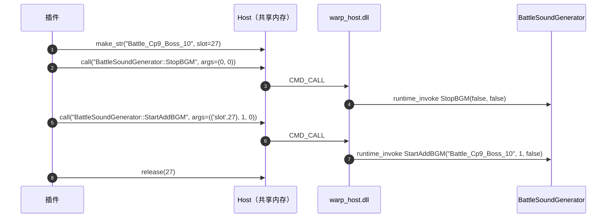

# 07 warp.audio —— 声音原语

`game.bgm()` 底下只有两步：停当前、播新的。要在这两步之间加东西（暂停、
恢复、查编号），用这一区。

```python
audio = _NS.space('warp').audio

host = game.live().host()          # 或自己 Host(...)
audio.play(host, 'Battle_Cp9_Boss_10')
```

!!! tip "大多数情况用 game.bgm 就够了"
    这一区是给「要自己拼序列」的插件准备的。只想换一首歌，
    看 [game 门面](02-game.md) 的 `bgm()`。

## 播放序列



三个细节都在图里：

- **字符串要先落进对象槽**（`make_str`），再用 `('slot', 27)` 当指针参数传。
  `call()` 的 `p` 类参数只认指针，直接传 Python 字符串不行。
- **`StopBGM` 两个参数都是 bool**，用 `0/1` 传。
- **`StartAddBGM` 收短名**，不带 `event:/BGM/Battle/`。
- 用完 `release(27)`，否则那个槽一直被占着。

## 函数

| 函数 | 返回 | 说明 |
| --- | --- | --- |
| `play(host, name, stop_current=True, timeout=2.0)` | `dict` | 停当前 + 播新的 |
| `stop(host, restore=True, timeout=2.0)` | `dict` | 停附加曲 |
| `pause(host, value, timeout=2.0)` | `dict` | `value=True` 暂停，`False` 继续 |
| `is_playing(host, timeout=2.0)` | `bool` | `BattleSoundGenerator.IsBattleBgmPlaying()` |
| `current_index(host, timeout=2.0)` | `int` 或 `None` | `BattleSoundGenerator.get_CurrentBgmIndex()`，读不到返回 `None` |
| `full_path(name)` | `str` | 补 `event:/BGM/Battle/` 前缀（已经是全长就原样返回） |
| `short_name(name)` | `str` | 截掉前缀；传进来的本来就是短名则原样返回 |

`play()` 的返回：

```python
{'ok': True,
 'name': 'Battle_Cp9_Boss_10',
 'path': 'event:/BGM/Battle/Battle_Cp9_Boss_10',
 'reason': ''}
```

`ok=False` 时 `reason` 是失败原因之一：`共享内存不可用` / `宿主未就绪` /
`超时` / `调用失败`。

## 常量

| 常量 | 值 | 含义 |
| --- | --- | --- |
| `BGM_PREFIX` | `'event:/BGM/Battle/'` | 战斗 BGM 的 event 前缀 |
| `STOP_MODE_IMMEDIATE` | `1` | `STOP_MODE` 立刻停（`play()` 用的这个） |
| `STOP_MODE_FADE` | `0` | 淡出停 |
| `SLOT_SCRATCH` | `27` | `play()` 用来放字符串的对象槽 |

## 自己写调用

不想用 `play()`，可以自己拼（比如要自定义 `STOP_MODE`）：

```python
host = game.live().host()
short = audio.short_name('Battle_Cp9_Boss_10')

made = host.make_str(short, slot=audio.SLOT_SCRATCH)
if made == '已执行':
    try:
        host.call('BattleSoundGenerator::StopBGM', args=(0, 0))
        result = host.call('BattleSoundGenerator::StartAddBGM',
                           args=(('slot', audio.SLOT_SCRATCH),
                                 audio.STOP_MODE_IMMEDIATE, 0))
        print('播放结果', result)
    finally:
        host.release(audio.SLOT_SCRATCH)
```

`call()` 的类型后缀是**自动拼的**（int → `i`、float → `f`、`('slot', n)` → `p`），
所以方法名后面不用自己写 `#pii`。完整规则（返回值处理、`ret="ref"`、
`('slot', n)` 用法）见 [plugin 篇的 call 一节](05-plugin.md)。

## 游戏底层方法（供参考）

`BattleSoundGenerator`（`dump.cs` 里 TypeDefIndex 491）是静态类，常用：

| 方法 | 签名 |
| --- | --- |
| `StopBGM` | `(bool isRelease, bool isFadeOut)` |
| `StartAddBGM` | `(string 短名, STOP_MODE beforeStopMode, bool isBeforeRelease)` |
| `StopAddedBGM` | `(STOP_MODE stopMode, bool isRelease)` |
| `StartBGM` | `(int index = -1, int timelineOffset = 0)` |
| `IsBattleBgmPlaying` | `() -> bool` |
| `get_CurrentBgmIndex` | `() -> int` |
| `PauseBGM` | `(bool)` |
| `GetCurrentBattleBGM` | `() -> EventInstance` |

!!! warning "所有 `BattleSoundGenerator` 方法都是静态的"
    调它们时 `Host.call(..., slot=None)` 就对了（不给实例）。给 `slot` 反而会失败。

## 边界

- **只在战斗场景有效**。主界面/剧情用的是另一套 BGM 系统。
- **游戏会抢**。回合切换时游戏自己调 `StopAddedBGM` / `StartBGM`，曲子会被换回去。
  要「保持这首」得每回合重放，见 [教程 07](../tutorial/07-bgm.md)。
- **不预加载 bank**。`SoundManager.LoadBankFromLocal` 要求知道 `StreamingAssets`
  绝对路径，WarpHook 不碰游戏文件；战斗曲都在游戏自带的 bank 里。
- **没有音量控制**。要淡入淡出得自己调 `SetParameterByName`，那属于接管音频。
