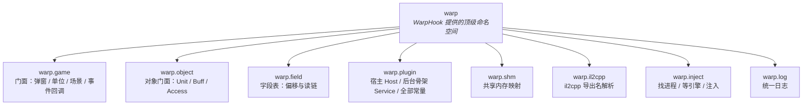
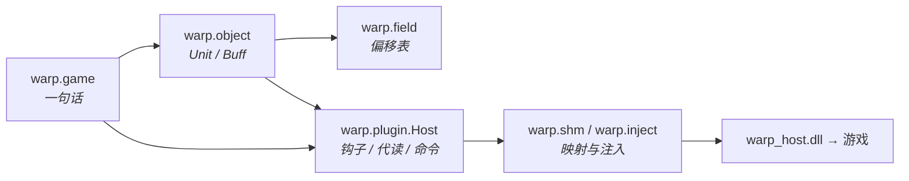

# 技术文档

这一分区是 **WarpHook 对外接口的完整清单**——每个命名空间、每个函数、每个常量、
每个类属性，以及怎么调用。教程里只讲常用的那几个，这里讲全部。

对应版本：**WarpHook 0.9.9 / 协议 v7**。

## 一眼看全



## 怎么取

```python
from typing import cast

ADDON_ARG = globals().get('ADDON_ARG') or {}
_NS = ADDON_ARG.get('Namespaces')
_W = cast("WarpNamespace", _NS.space('warp'))

game = _W.game          # 日常够用
obj = _W.object         # 要更细的对象操作
fld = _W.field          # 要查偏移
plugin = _W.plugin      # 自己管宿主、写钩子
```

也可以从根上扁平取：`_NS.space('warp.game')`，等价于 `_W.game`。

## 分区索引

| 分区 | 提供什么 | 什么时候用 |
| --- | --- | --- |
| [warp.game](02-game.md) | `popup` `units` `battle` `on_round_start` … | **默认用这个**，前七篇教程全靠它 |
| [warp.object](03-object.md) | `Unit` `Buff` `Access` + 槽常量 | 已经拿到单位、要读字段或 buff |
| [warp.field](04-field.md) | `FIELD_TABLE` `read_chain` `unit_path` … | 想知道某个偏移是什么、自己拼链 |
| [warp.plugin](05-plugin.md) | `Host` `Service` `Runtime` + 所有 `HF_*` `CMD_*` `HOST_*` 常量 | 自己写钩子、拦动作、管注入 |
| [warp.shm](06-lowlevel.md#warp-shm) | `open` `SharedMap` `ensure_exports` | 自己做一块共享内存（少见） |
| [warp.il2cpp](06-lowlevel.md#warp-il2cpp) | `resolve` `names_table` `export_mapped` | 解析游戏导出函数名 |
| [warp.inject](06-lowlevel.md#warp-inject) | `find_pid` `wait_for_game` `inject` | 自己做注入流程（少见） |
| [warp.log](06-lowlevel.md#warp-log) | `write` | 打日志 |
| [命名空间机制](01-namespaces.md) | 插件怎么互相提供能力 | 想让别的插件用你的功能 |

## 三层调用关系



**越往下越强，也越要负责。** 上面一层能做的事下面都做得到，只是要自己拼参数。
