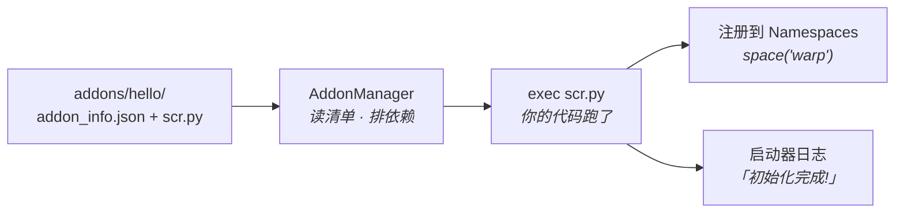

# 01 第一个插件

这一篇的目标只有一个：**让启动器加载你的插件，并在日志里看到你自己打的一行字。**
不钩任何游戏函数，不读任何内存。先把「插件能被加载」这条链路跑通，后面所有东西才站得住。



一个插件就是**一个目录、两个文件**。没有编译、没有打包、没有入口函数。

## 插件长什么样

一个插件就是一个目录，放在启动器目录下的 `addons/` 里：

```text
FaustLauncher/
├─ addons/
│  ├─ WarpHook/          ← 依赖库，你不用改
│  └─ 你好世界/           ← 你的插件，目录名随便起，但别跟别人重名
│     ├─ addon_info.json  ← 清单：叫什么、依赖谁、有哪些设置
│     ├─ scr.py           ← 代码：启动器直接 exec 这个文件
│     └─ icon.png         ← 可选，列表里显示的图标
```

只有两个文件是必需的：`addon_info.json` 和 `scr.py`。文件名不能改。

## addon_info.json

```json
--8<-- "docs/examples/hello/addon_info.json"
```

逐项说明：

| 字段 | 必填 | 说明 |
| --- | --- | --- |
| `name` | ✅ | 显示名。菜单、设置页、日志里都用它 |
| `desc` | ✅ | 介绍。用户在插件列表里能看到的说明文字，支持换行 |
| `authors` | | `{"作者名": "主页链接"}` |
| `requires` | ✅ | 依赖的插件名数组。写 `["WarpHook"]` 后，启动器会**先加载 WarpHook 再加载你**；缺依赖时你根本不会被载入 |
| `settings` | ✅ | 设置项的默认值。用户改了以后启动器会写回这个文件 |
| `settings.enable` | ✅ | `true` = 默认启用。用户停用后启动器不会 `exec` 你的 `scr.py` |
| `version` | ✅ | 你的插件版本，只用于显示和排查 |

!!! warning "别把 `enable` 写成 `false`"
    很多人第一次写插件，照抄模板把 `enable` 留成 `false`，然后死活看不到日志。
    启动器会打印 `插件 xxx 被禁用，跳过载入` —— 但如果你没在控制台前盯着，很容易漏掉。

## scr.py

```python
--8<-- "docs/examples/hello/scr.py"
```

要点：

**1. 没有 `main()`，也没有注册函数。** 启动器把你的 `scr.py` 整个 `exec` 一遍，文件里
顶层的代码就是「初始化」。要注册钩子、起线程、读设置，都写在顶层或者从顶层调。

**2. `ADDON_ARG` 是启动器塞给你的字典。** 它不是 import 进来的，是 exec 时直接放进了
模块全局命名空间。里面固定有这四样：

| 键 | 是什么 |
| --- | --- |
| `AddonName` | 你这个插件的名字（就是目录名） |
| `AddonManager` | 启动器的插件管理器，`get_addon_info(名字)` 能拿清单和设置 |
| `Namespaces` | 命名空间容器，`space('warp')` 拿到 WarpHook 的能力（第 02 篇用） |
| `ExtendTranslateSource` | 往启动器的翻译源里加词条，一般用不到 |

**3. 打日志用 `print(..., flush=True)`。** 启动器的控制台里能看到；写没写 `flush=True`
决定了它是「立刻出现」还是「攒一批才出现」——排查问题时差别很大。

## 装上去看效果

1. 把 `你好世界/` 整个目录复制到 `addons/` 下；
2. 重启启动器（插件只在启动时执行一次，改了代码就得重启，没有热重载）；
3. 看日志，应该有两行：

```text
载入插件 你好世界...
[你好世界] 你好，世界
[你好世界] 我拿到的东西：['AddonManager', 'AddonName', 'ExtendTranslateSource', 'Namespaces']
插件 你好世界 初始化完成!
```

改一下 `addon_info.json` 里的 `招呼语`，重启启动器，第二行就跟着变了——这一圈跑通，
说明「清单 → 设置 → 代码」这条链路是活的。

## 日志在哪

| 位置 | 内容 |
| --- | --- |
| 启动器控制台 | 实时输出，调试最方便 |
| 启动器目录的 `logs/` | 每次运行一个文件，出问题要发给别人看的是这个 |
| `addons/WarpHook/warp.log` | **WarpHook 唯一的日志文件**，宿主 DLL 与插件写在同一个文件里（第 02 篇起会用到） |

### 只看一个文件：`warp.log` {#log-file}

以前 WarpHook 会摊出三个日志（DLL 一份、Python 一份、事件流水一份）外加各自的轮转备份，
时间一长就是一堆互相错位的文件。现在整个 WarpHook 只写 `addons/WarpHook/warp.log`：

```
2026-11-01 22:24:33.512 pid=9320 thread=MainThread ==== WarpHook host pid=9320 at 22:24:33 injected, truncated (whole addon shares this one file) ====
2026-11-01 22:24:33.512 pid=9320 thread=MainThread ==== WarpHook 0.9.39 pid=9320 启动于 2026-11-01 22:24:33 ——— 本进程日志从空文件开始，重跑启动器即覆写 ====
2026-11-01 22:24:33.640 pid=9320 thread=pygame [host] [WarpHook] 钩子安装 32/32 err=0
2026-11-01 22:24:34.110 pid=9320 thread=pygame [event] EVT ev=battle.StartBattle slot=12 rv=0
```

行首那几列（时间、pid、线程）不用记，看后面的部分：

| 位置 | 含义 |
| --- | --- |
| `==== … WarpHook host …` | 宿主 DLL 刚注入，这一行**清空**了旧内容 |
| `==== WarpHook 0.9.39 …` | Python 侧启动，这一行**又**把文件清空 |
| `[host]` | 启动器 / 宿主 DLL 侧：装配、`configure`、钩子安装、命令通道、异常 |
| `[event]` | 事件流水：每次钩子命中一条，用来核对「回调到底有没有跑」 |
| `pid=` / `thread=` | 多线程出问题时先按这两列对齐时间 |

两条 `====` 都在开头是正常的：DLL 先被塞进游戏进程、Python 侧稍后接管，谁先跑谁清空，
最后活下来的是**这一轮**的完整记录。也正因为「启动即覆写」：

- **别指望它当历史存档。** 想看上一轮的，启动器退出后自己拷走。
- **别只凭「已注入」就断定成功。** 要看到 `[host]` 里钩子确实装上、`[event]` 里确实有命中。
- **磁盘上没有别的 WarpHook 日志了。** 还看到 `warp_host.log` / `warp_events.log` /
  `warp_python.log` 的话，那是旧版本留下的残渣，删掉即可（`.gitignore` 也已排除它们）。

## 没反应？按这个顺序查

1. **目录结构对不对**：`addons/你好世界/scr.py`，不是 `addons/你好世界/你好世界/scr.py`。
2. **文件名对不对**：必须是 `scr.py`（不是 `main.py`、不是 `script.py`）。
3. **`settings.enable` 是 `true` 吗**。
4. **`requires` 里的插件在不在**：写 `"WarpHook"` 但 `addons/WarpHook/` 不存在，你会被跳过，
   日志里的原因是 `插件 你好世界 跳过载入（缺少依赖: WarpHook）`。
5. **代码报错了吗**：`exec` 抛异常时日志是 `插件 你好世界 载入失败: <异常信息>`。
   这时把 `scr.py` 里出错的几行注释掉再试，二分定位。

## 到这一步你该知道的

- 插件 = `addons/<名字>/` + `addon_info.json` + `scr.py`
- 顶层代码 = 初始化
- `ADDON_ARG` 是启动器给的上下文
- `on_unload()` 是收尾

下一篇我们让游戏自己弹一句话出来——那是插件真正开始「影响游戏」的第一步。
