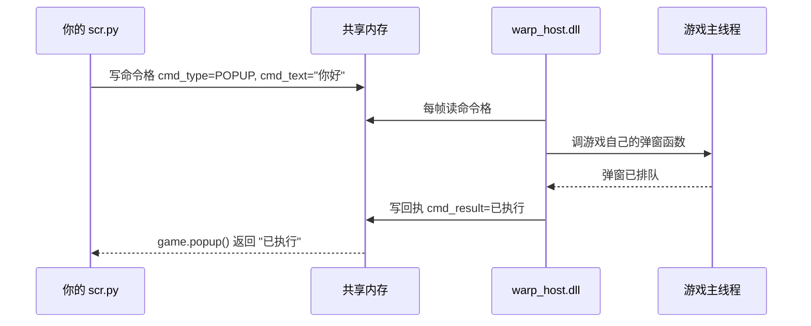

# 02 让游戏弹一句话

上一节的插件只会自己说话。这一节让**游戏**说话。

目标：游戏跑到标题画面，弹出一个原版系统弹窗，内容是你在设置里写的那句话。

整件事只需要一行：

```python
game.popup('来自插件的问候')
```

## 先花两分钟搞清楚为什么是「一行」

你的 `scr.py` 跑在**启动器**进程里，游戏是**另一个进程**。两个进程的内存互相看不见，
你没法直接调游戏的函数。

WarpHook 的做法是往游戏进程里塞一个 DLL（`warp_host.dll`），由它在游戏的线程里替你
调游戏的函数。启动器和这个 DLL 之间靠一块**共享内存**通信：



关键点：**Python 从来不在游戏的线程上**。它只是往共享内存里放一张纸条，
宿主每帧路过时看一眼，替它去调游戏。


`game.popup()` 把这条链路上所有麻烦事都做完了：

1. 等 `LimbusCompany.exe` 启动；
2. 等 `GameAssembly.dll` 加载完（il2cpp 初始化完成）；
3. 把 `warp_host.dll` 注入进去（已经注入过就跳过）；
4. 等宿主开始工作（`hooked`）；
5. 写命令、等游戏回话、把结果返回给你。

**这些都不是魔法，但也不是你需要关心的事。** 想自己控制就用后面会讲的
`warp.plugin.Service`，不想关心就一行。

## 完整代码

```python
--8<-- "docs/examples/popup/scr.py"
```

```json
--8<-- "docs/examples/popup/addon_info.json"
```

## 三个要知道的点

### 1. `game.popup()` 会**等**

```python
game.popup('你好')   # 游戏没开就等它开；最多等 120 秒
```

它不是「发出去就走」，而是等游戏那边回话（默认最多 2 秒）。
所以**游戏里弹窗没关之前，游戏是停着的**——这是游戏自己的行为，不是插件的锅。

如果你不想等：

```python
game.popup('你好', wait=False)   # 不等宿主就绪，立刻发（没注入就会失败）
game.popup('你好', wait_timeout=10)  # 最多等 10 秒
```

### 2. `game.start()` 是「提前开工」

```python
game.start(menu=(
    ('弹一句', lambda: _say()),
))
```

不调它也行，第一次 `popup()` / `units()` 时会自动开工。
提前调的好处是能顺便把**托盘菜单**挂上——用户右键插件就能点。

### 3. 回收交给 `on_unload`

```python
def on_unload():
    game.close()
```

`close()` 会停掉后台线程、断开共享内存。不写也不会立刻出事（进程退出时系统会收），
但插件被反复重载时会攒下一堆线程。

## 日志里能看到什么

```text
[弹一句] 等待游戏启动…
[弹一句] 已注入（PID 12345）
[弹一句] 工作中，命中 0 次 / 已生效 0 次
[弹一句] 弹窗「来自插件的问候」→ 已执行
```

最后那句的 `已执行` 是游戏那边的回执。常见的其它回执：

| 回执 | 含义 |
| --- | --- |
| `已执行` | 成功 |
| `共享内存不可用` | 宿主没起来（游戏没开 / 注入失败） |
| `游戏未就绪` | DLL 在，但游戏主循环还没跑起来 |
| `超时` | 游戏卡住了（比如你弹窗没关） |

## 没弹出来？按这个顺序查

1. `game.status()` 里 `hooked` 是 `False` → 看 `log_tail` 那一行，通常是注入失败；
2. `game.status()` 里 `standalone` 是 `True` → 启动器已经退出了，DLL 还在游戏里跑（正常现象）；
3. 日志里有 `pump: no free entry point` → 有人抢占了宿主的命令通道，见第 08 篇；
4. 弹窗内容为空字符串 → 游戏会直接忽略，日志里是 `popup: empty text`。

## 这一篇你该记住的

- **一行 `game.popup('...')` 就能让游戏说话**，等游戏、注入、回执都在里面
- 插件跑在启动器进程，游戏在另一个进程，中间靠 `warp_host.dll` + 共享内存
- `game.start(menu=...)` 可以提前开工并挂托盘菜单
- `on_unload()` 里 `game.close()`

下一篇换个方向：让游戏在发生事情的时候主动通知你。
