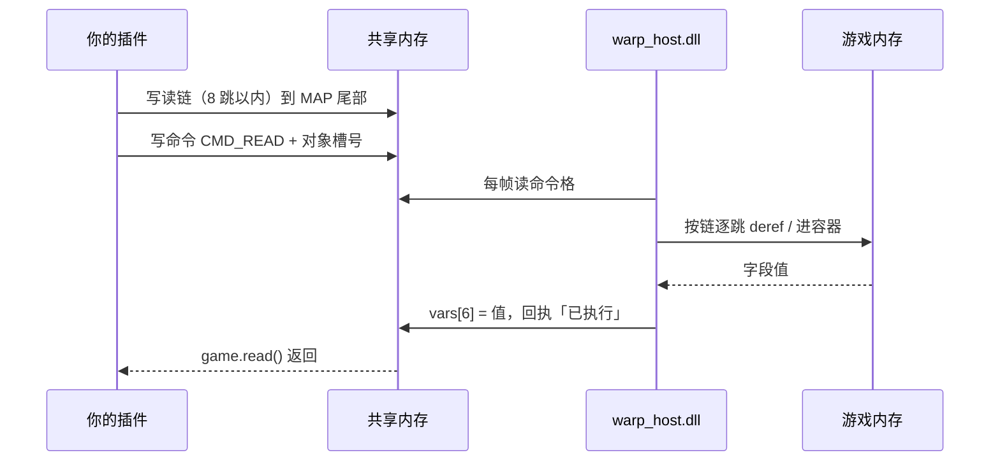

# 04 读一个单位

前三篇都在「让游戏做事」。这一篇开始**读数据**——这是所有信息类插件的基础。

场上每个单位在 `warp.game` 里都是一个 `Unit` 对象。你不需要知道它是哪个类、
字段在哪个偏移，只要拿对象和读属性：

```python
u = game.player()      # 我方第一个单位
print(u.id, u.hp, u.max_hp, u.sp, u.speed)
```

## 怎么拿到一个单位

| 写法 | 拿到的 |
| --- | --- |
| `game.units()` | 场上全部单位（列表） |
| `game.count()` | 场上几个单位 |
| `game.unit(id=1)` | 按**界面上的编号**找 |
| `game.unit(identity=10115)` | 按**人格 ID** 找（浮士德魁首 = 10212） |
| `game.unit(index=0)` | 按列表第几个找 |
| `game.player()` | 我方第一个 |

`id` 和 `identity` 是不同的东西，别混：

- **`id`**（编号）是**战斗内**的序号，1、2、3……下次战斗就重排了；
- **`identity`**（人格 ID）是角色本身的静态编号，10115 永远是同一个角色。

插件里判断「这是不是浮士德」，用 `identity`；给玩家显示「第 3 号单位」用 `id`。

## `Unit` 能读什么

`u.` 后面这些属性，每一个都是**一次真实的内存读取**：

| 属性 | 含义 | 例子 |
| --- | --- | --- |
| `u.id` | 战斗内编号 | `1` |
| `u.identity` | 人格 ID（`origin_id` 也可以） | `10115` |
| `u.hp` | 当前血量 | `245` |
| `u.max_hp` | 最大血量 | `248` |
| `u.sp` | 理智（SP），负数表示恐慌计数 | `45` |
| `u.speed` | 速度（已从定点数除回） | `5.661` |
| `u.hp_ratio` | 血量比例 0..1 | `0.987` |
| `u.alive` | 还活着 | `True` |
| `u.is_dead` | 已阵亡 | `False` |
| `u.is_break` | 混乱（崩溃条满） | `False` |
| `u.is_panic` | 恐慌（理智归零后的失控） | `False` |
| `u.is_low_morale` | 士气低落 | `False` |
| `u.index` | 在列表里的下标 | `0` |

这些值都是**混淆过的**，WarpHook 已经帮你解开了。`is_break` 这类布尔返回
`True` / `False` / `None`（读不到时是 `None`，而不是 `False`——这个区别很重要，
不要把 `None` 当成「没混乱」）。

## 示例：看看我方

```json
--8<-- "docs/examples/read-unit/addon_info.json"
```

```python
--8<-- "docs/examples/read-unit/scr.py"
```

菜单里点「看看我方第一个」，日志：

```text
[看看我方] 编号 1   人格 10115
[看看我方] 血量 245 / 248   （99%）
[看看我方] 理智 45
[看看我方] 速度 5.661
[看看我方] 活着 True   混乱 False   恐慌 False
```

## 代价：每次读都是一次往返

这一点必须刻在脑子里。读一个属性，实际发生的是：



**一次 20–40 毫秒。** 所以：

```python
for u in game.units():        # 11 个单位
    print(u.hp, u.sp, u.speed)  # ×3 个属性 ×11 = 33 次往返 ≈ 1 秒
```

这不算慢到不能用（回合级回调完全够），但**别放在高频路径上**。两个省时间的办法：

1. **只读你要的**：只要血量就别碰 `props()`；
2. **要很多字段就一次性拿**：`snapshot()`、`u.props()`——见下一篇。

## 读不到的时候

属性返回 `None` 通常有三个原因：

| 现象 | 原因 |
| --- | --- |
| 全部是 `None` | 不在战斗里，或者游戏没开 / WarpHook 没注入 |
| 只有某几个是 `None` | 那个字段的偏移对这个角色不适用（比如 `identity` 在杂兵身上是 `0`） |
| `game.units()` 是空的 | 还没打第一个回合（管理器是在回合开始时才被抓住的） |

第三种最坑：`game.units()` 依赖「回合开始」这条钩子来抓住全局管理器。刚进战斗、
还没开始第一回合的时候，它拿不到任何东西。想让插件一进战斗就能读，就等第一回合
（`game.on_round_start` 里做），或者调用 `game.battle(timeout=60)` 让它自己等一会。

## 这一篇你该记住的

- `game.units()` / `game.unit(id=…)` / `game.unit(identity=…)` / `game.player()`
- `id` 是战斗内编号，`identity` 是人格 ID，判断角色用后者
- `u.` 属性每次都是一次 20–40ms 的跨进程往返，别在高频路径里刷
- 读不到的字段返回 `None`，别把 `None` 当 `False`
- 刚进战斗、还没过第一回合时拿不到单位

下一篇把「读一堆字段」的成本压下来。
