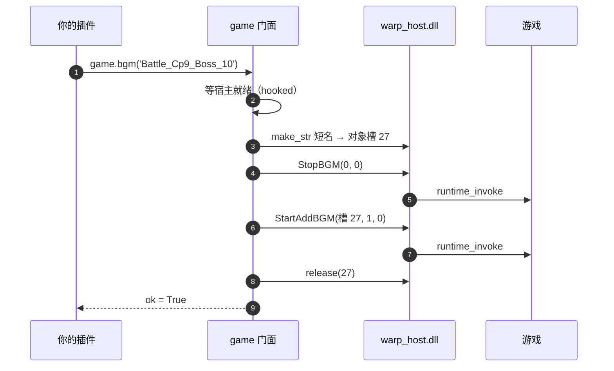

# 07 放一首 BGM

战斗里的背景音乐能换。一行：

```python
game.bgm('Battle_Cp9_Boss_10')
```

`Battle_Cp9_Boss_10` 是曲子名，就是游戏 `StreamingAssets` 里那些
`Battle_*` 的名字。前缀 `event:/BGM/Battle/` 不用写，写了也行。

!!! note "只在战斗里有效"
    这套接口操作的是战斗 BGM 系统（`BattleSoundGenerator`）。主界面、剧情、
    商店用的是另一套，在那些场景调 `game.bgm()` 不会有声音。

## 先看一个能跑的

`addons/bgm/`（从 [示例目录](https://github.com/f0lkskill/FaustLauncher/tree/main/docs/examples/bgm) 复制）
—— 装三个菜单，点一下就换曲：

```
addons/换首歌/
  ├── addon_info.json
  └── scr.py
```

```json title="addon_info.json"
--8<-- "docs/examples/bgm/addon_info.json"
```

```python title="scr.py"
--8<-- "docs/examples/bgm/scr.py"
```

装上之后：

1. 打开菜单，点「换成设置里的曲子」；
2. 战斗里应该换成了 `Battle_Cp9_Boss_10`；
3. 点「恢复游戏原曲」，游戏自己的 BGM 回来。

## 四个函数

| 函数 | 做什么 |
| --- | --- |
| `game.bgm(name, stop_current=True)` | 换曲。`stop_current=False` 就不先停当前那首 |
| `game.bgm_stop(restore=True)` | 停掉附加曲。`restore=True` 时把游戏原曲放回来 |
| `game.bgm_playing()` | 现在有没有 BGM 在播 |
| `game.bgm_index()` | 当前曲目编号（游戏自己的编号，不是字符串） |

四个都返回「马上就能用」的结果，不需要你自己等宿主就绪 —— 和
[弹窗](02-popup.md) 一样，`bgm()` 默认会等到能发命令为止（游戏没开最多等 120 秒）。
不想等就传 `wait=False`，那时返回 `{'ok': False, 'reason': '...'}`。

`bgm()` 的返回值：

```python
{'ok': True, 'name': 'Battle_Cp9_Boss_10',
 'path': 'event:/BGM/Battle/Battle_Cp9_Boss_10', 'reason': ''}
```

`ok` 为 `False` 时看 `reason`。

## 一次换曲发生了什么



这五步（等宿主 / 造字符串 / 停旧的 / 放新的 / 还槽位）都能单独拿出来用，
见底下的 `warp.audio`。

## 曲子会被游戏抢回去

这是这套接口唯一需要想清楚的地方。

游戏在回合切换、战斗结束、进入下一阶段时会自己调「停附加曲 / 换回原曲」。
你在回合开始时换的歌，可能下一回合就没了。

办法是**每回合重放一次**：

```python
SONG = 'Battle_Cp9_Boss_10'

def _keep(battle):
    if game.bgm_playing():
        return                      # 还在播，别打断
    game.bgm(SONG)

game.on_round_start(_keep)
```

`BattleBGMExtend`（随启动器发布的一个插件）就是这么干的 —— 它按人格和 buff
判断该放哪首，每回合重新判定、必要时重放。想学怎么把「条件 → 曲子」做成
规则表，直接读它的 `scr.py`。

## 底层：自己拼播放序列

`game.bgm()` 底下只有两步：停当前、播新的。要加别的动作（先暂停、调节参数），
用 `warp.audio`：

```python
audio = _W.audio

audio.play(host, 'event:/BGM/Battle/Battle_Cp9_Boss_10')   # 前缀随便写
audio.pause(host, True)
audio.is_playing(host)
audio.current_index(host)
```

| 函数 | 做什么 |
| --- | --- |
| `audio.play(host, name, stop_current=True, timeout=2.0)` | 停当前 + 播新的，返回 `{'ok','name','path','reason'}` |
| `audio.stop(host, restore=True)` | 停附加曲，可选恢复原曲 |
| `audio.pause(host, value)` | 暂停 / 继续 |
| `audio.is_playing(host)` / `audio.current_index(host)` | 状态 |
| `audio.full_path(name)` / `audio.short_name(name)` | 补 / 截前缀 |

!!! warning "`StartAddBGM` 收的是短名"
    游戏那个方法是 `StartAddBGM(string 短名, ...)`，传全长
    `event:/BGM/Battle/xxx` 会静默不播。`audio.play()` 内部已经帮你截短了，
    但你要是自己 `host.call('BattleSoundGenerator::StartAddBGM', ...)`，
    记得先 `audio.short_name()`。

## 完整方法表

`game` 这一区的所有函数、`audio` 原语、返回结构与错误码，见
[技术文档 · game](../technical/02-game.md) 与
[技术文档 · audio](../technical/07-audio.md)。

下一篇：[插件怎么收尾](08-lifecycle.md) —— 后台线程、`on_unload`、热重载的真相。
