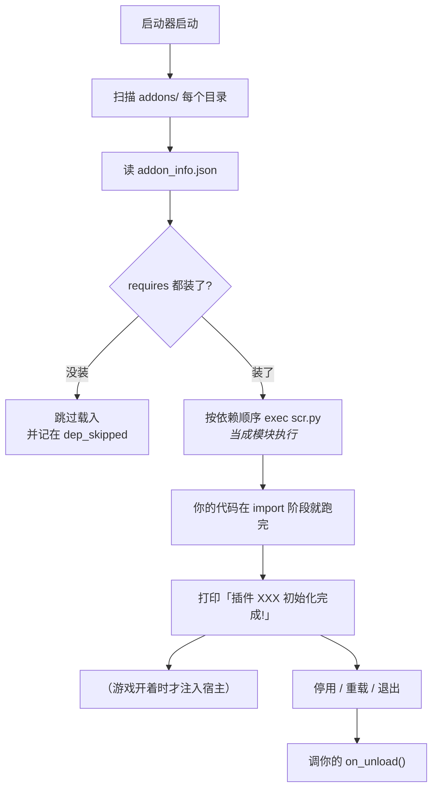

# 07 生命周期与线程

前六篇都在「用」，这一篇讲「怎么不出事」。

## 插件是怎么被载入的



顺序是**拓扑排序**：`requires` 里写的插件一定先执行完，所以你 `space('warp')` 的时候
WarpHook 已经注册好了。反过来，别的插件 `space('你的插件')` 也能拿到你 provide 的东西。

**没有 `main()`、没有入口函数。** 模块被执行的那一刻你的插件就活了，所以：

```python
game.on_round_start(_on_round)     # ✅ 在模块顶层注册
game.start(menu=(...))             # ✅ 在模块顶层启动
```

不要写在 `if __name__ == '__main__'` 里——那个条件在这里永远不成立。

## `ADDON_ARG` 里有什么

每个插件被载入时，启动器往模块全局塞了一个字典：

| 键 | 是什么 |
| --- | --- |
| `AddonName` | 你的插件名（`addon_info.json` 的 `name`） |
| `AddonManager` | 插件管理器（能问装了什么、读设置） |
| `Namespaces` | 命名空间入口，`_NS.space('warp')` 拿 WarpHook |
| `ExtendTranslateSource` | 翻译扩展入口（用不上就别管） |

标准开头三行：

```python
ADDON_ARG = globals().get('ADDON_ARG') or {}
ADDON_NAME = ADDON_ARG.get('AddonName') or '我的插件'
_W = ADDON_ARG.get('Namespaces').space('warp')
```

## 一定要写 `on_unload`

插件被卸载（启动器退出、玩家手动关掉）时，启动器会调你模块里的 `on_unload()`：

```python
def on_unload():
    game.close()
```

不写的后果：后台线程还在跑，进程退不干净，下次启动可能冲突。

`game.close()` 会做四件事：停心跳线程、注销所有回调、关共享内存、把钩子清掉。
如果你用的是 `game.start()`，这是唯一需要调的东西——**`_W.registry.on_unload()` 
也会兜底调 `live.close_all()`**，但自己写一句更清楚。

!!! warning "别在 on_unload 里做慢事"
    卸载是「立刻就要退」的时刻。读全场、写大文件、等网络都别放这里。
    要保存数据，在平时就写掉。

## 线程模型：你在谁的线程上

| 你的代码在哪 | 跑在哪个线程 | 能做什么 |
| --- | --- | --- |
| `scr.py` 顶层（载入时） | 启动器的主线程 | 快，别阻塞 |
| `game.on_round_start(...)` 的回调 | WarpHook 的心跳线程 | 可以慢，可以 `sleep` |
| `menu=(...)` 里点的菜单项 | 启动器 UI 线程 | 别阻塞太久，会卡界面 |
| `game.popup()` 的等待 | 当前线程 | 最长等 `wait_timeout`（默认 120 秒） |

关键点：**游戏那边从来不会调用你的 Python**。所有「游戏发生了事」都是你的心跳线程
在轮询发现的。这个设计让你 `sleep` 很安全（不会卡游戏），代价是通知有最多 0.25 秒的延迟。

## 常见的三个坑

### 坑 1：没人打开菜单

`game.start(menu=...)` 里的菜单要启动器 UI 打开才有得点。纯后台插件（只在回合回调里干活）
不需要菜单，`game.start()` 也能不带参数。

### 坑 2：重复启动

```python
game.start()    # ✅ 调一次
```

`game.start()` 内部按插件名记账，同一个插件调两次不会起两个心跳线程。但如果你在
`on_round_start` 回调里又调了一次 `start()`，那就是自己给自己找麻烦——**模块顶层调一次就够**。

### 坑 3：等太久以为插件死了

```python
u = game.player()
```

游戏没开 / 还没进战斗时，这类调用会**等**（默认等几十秒）。日志里没输出不代表插件
死了，可能只是在等。要立刻拿到结果、失败就返回 `None`，用底层接口自己判：

```python
host = _W.plugin.Host(ADDON_NAME)
if host.status()['hooked']:      # 宿主已就绪
    ...
```

## 调试三件套

1. **日志**：`print(msg, flush=True)`——`flush` 一定要有，否则日志会攒在缓冲区里
   看不见。输出位置：启动器控制台 + `logs/` 目录。
2. **菜单**：把调试动作挂到 `menu` 上，随时点一下就触发，不用重启。
3. **状态**：`game.describe()` 返回一行人类可读的状态，打到日志里最省事。

```python
game.start(menu=(('打印状态', lambda: _log(game.describe())),))
```

## 发版要注意的

- `addon_info.json` 的 `version` 改一下（`0.1.0` → `0.1.1`），玩家能看到更新；
- `requires` 里写清楚 `["WarpHook"]`，否则玩家装的时候可能缺依赖；
- `settings.enable` 别写成 `false`——那样插件自己会把自己关掉；
- 改了 `scr.py` 要重启启动器才生效（模块只在载入时执行一次）。

## 这一篇你该记住的

- 没有 `main()`，模块执行即启动；顶层注册回调、顶层 `game.start()`
- 必须写 `on_unload()` 调 `game.close()`
- 游戏不会调你，是你轮询发现——所以 `sleep` 安全，延迟最多 0.25 秒
- 菜单回调在 UI 线程，别在里面跑慢活
- 日志用 `print(..., flush=True)`，调试动作挂菜单

到这里主线七篇就完了。想动「游戏行为本身」（拦截、改逻辑），去第 08 篇。
想查具体字段、协议细节、历史教训，去参考手册。
