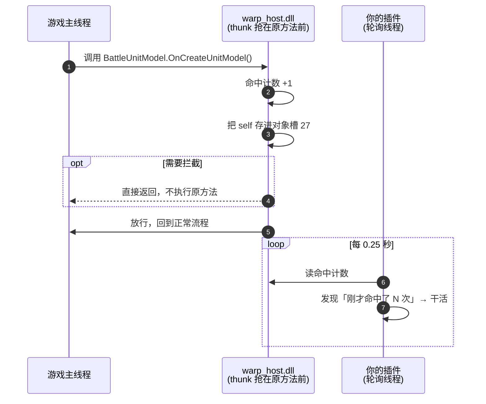

# 08 想改游戏行为：到底层去

前面七篇用的都是 `game.*` 这类包装好的函数——你不需要认识类名、方法名、偏移。
但有一类需求包装函数给不了：**在游戏执行某个方法的瞬间插一脚，甚至把它拦下来。**

这一篇讲底层。它是 `game.*` 下面藏着的东西，也是所有「修改游戏逻辑」类插件的起点。

!!! note "什么时候需要看这一篇"
    - 想拦下游戏的动作（禁止抽卡扣钱、阻止某段剧情）
    - 想在 `game.*` 没提供的事件上动手（比如「某技能释放时」）
    - 想读 `game.units()` 之外的对象

    只是想读场上单位、血量、buff，前六篇的写法就够了，不用回来。

## 心跳模型



**游戏那边只做计数**，重活全在插件进程里。所以你的回调慢一点也不会卡游戏，
代价是通知有最多 0.25 秒的延迟。

注意这里没有「游戏调用 Python」这种事——**Python 不在游戏的线程里**。
游戏那边只做计数和最轻的记录，插件这边靠轮询发现「刚才命中了 N 次」。
这个模型决定了后面所有行为的边界，先记住它。

## 一个钩子就是一个 dict

```python
{
    'klass': 'BattleUnitModel',     # 类名
    'method': 'OnCreateUnitModel',  # 方法名
    'argc': 0,                      # 参数个数（不含 self）
    'actions': 0,                   # 0 = 只看不碰
    'cache': (0, 27),               # 命中时把 self 存进对象槽 27
}
```

常用字段全表：

| 字段 | 默认 | 作用 |
| --- | --- | --- |
| `klass` / `method` | — | 要钩的方法，**必须跟 dump 里的名字一字不差** |
| `argc` | `0` | 参数个数（不含 `self`）。数错了整个调用会错位 |
| `actions` | `0` | 动作位。`0` 只看；`flags` 里的 `HF_BLOCK` 才是「拦」 |
| `flags` | `0` | `HF_BLOCK`(0x01) 拦下原方法 / `HF_ONCE`(0x02) 只触发一次 / `HF_DEDUPE`(0x04) 值没变就不投递 |
| `cache` | — | `(参数序号, 槽号)`：命中时把那个参数（`0` 是 `self`）的指针存进对象槽 |
| `guard` | — | `(vars 槽号, 值)`：那个槽等于这个值时才放行（当开关用） |
| `every` | `1` | 每 N 次命中才算一次 |
| `chance` | `100` | 触发概率（百分比），调试随机效果用 |
| `delay_ms` | `0` | 命中后延迟多久再执行动作 |
| `when` | `0` | `1` = 在原方法**调用之后**才处理（构造函数要读的字段是之后才填好的） |
| `ret_kind` / `ret_slot` | — | 把原方法的返回值取出来（`'int32'`/`'float'`）放进事件的某一格 |
| `reads` | — | 命中时直接读几个字段（读链写法见参考手册） |
| `event` | — | 每次命中都往事件队列塞一条现场记录 |

## 完整示例：看住「单位被创建」

```python
--8<-- "docs/examples/hook/scr.py"
```

```json
--8<-- "docs/examples/hook/addon_info.json"
```

跑起来后，每进一次战斗，日志里会刷出一串：

```text
[单位观察] 第 1 个单位：指针 0x1DA198BFD80，编号 1
[单位观察] 第 2 个单位：指针 0x1DA1990A1C0，编号 2
...
```

## 三种典型用法

### 只看：`actions: 0`

游戏照常走，我们只是知道「它刚才调了这个方法」，并且顺手把 `self` 存了下来。
上面的示例就是这种。适合做统计、记录、触发后续逻辑。

### 拦下：`flags: HF_BLOCK`

原方法**不会执行**，游戏就像什么都没发生。

```python
{
    'klass': 'BattleActionModelManager', 'method': 'Init',
    'argc': 0, 'actions': 0,
    'flags': _W.plugin.HF_BLOCK,
}
```

这能做出「禁止抽卡扣钱」「不触发某段剧情」这类效果。但要想清楚：**拦掉一个方法，
它的调用方会以为成功了**，后面可能拿到 `null` 或默认值。拦之前先确认调用方容错。

### 按条件拦：`guard`

想「只在某种情况下动手」，用 `guard` 接一个开关变量：

```python
'guard': (0, 1)     # vars[0] == 1 时才放行（不拦）
```

配合 `host.popup`/`host.set_enabled`，就能做出托盘菜单里的开关效果。
具体怎么往 `vars` 里写值，见参考手册的命令通道一节。

## 对象槽：把游戏的对象「挂」在这里

`cache: (0, SLOT_UNIT)` 的意思：命中时把 `self` 的指针抄进**对象槽 27**。
之后任何时候都能用这个槽出发读东西：

```python
ptr = host.object_ptr(27)                                    # 拿指针本身
value = host.read(27, [{'off': 0x60, 'deref': False}], 'int')  # 从它出发读一个字段
```

槽一共 32 个，被分成几段：

| 槽 | 用途 |
| --- | --- |
| 0..23 | 成就插件的主段（**别用**，会和它互相覆盖） |
| 24..26 | 你自己随便用 |
| 27..28 | 建议插件从 27 起用 |
| 29 | 宿主每帧缓存的场景根对象（`GlobalGameManager`） |
| 30 / 31 | 宿主每帧回调的保留位 |

## 选靶子的三条经验

这三条都是踩出来的，能省你很多时间：

!!! danger "① 小 getter 钩不到"
    `CharacterState::get_Hp`、`BattleUnitModel::get_Position` 这种一行返回的
    getter，在 AOT 编译时经常被**内联**到调用方里——方法本身还在，但游戏永远不会
    真的「调用」它，所以钩子永远不命中。**选体积大、带循环、带参数的方法。**

!!! danger "② 同一个方法只能挂一条钩子"
    如果成就插件已经钩了 `BattleUnitModel.RefreshSpeed`，你再钩它就装不上，
    日志里是：

    ```text
    hook: target already hooked elsewhere (27)
    ```

    换一个方法，或者用第 05 篇的「静态调用」完全绕开钩子。

!!! danger "③ 别看错类"
    `BattleUnit` 和 `BattleUnitModel` 是两个不同的东西：`BattleUnit` 是你点选的那个
    「场上格子」，`BattleUnitModel` 才是它的数据本体。钩错类什么也拿不到。

## 装上去试

1. 把 `单位观察/` 放进 `addons/`，重启启动器，进战斗；
2. 日志里每回合开始会刷出单位编号；
3. 想确认钩子真的挂上了，看 `addons/WarpHook/warp_host.log`，应该有：

```text
hook installed (27)
```

括号里是你占的槽号。如果看到 `hook: class not found (27)`，说明类名写错了；
`hook: method not found (27)` 是方法名写错了。

## 到这一步你该知道的

- 钩子 = 一条 dict，描述「哪个类的哪个方法、要不要拦、要不要顺手存东西」
- 游戏那边只计数，插件这边轮询 —— **不要在回调里假设自己在游戏的线程上**
- 三个 flag：拦（`HF_BLOCK`）、只一次（`HF_ONCE`）、去重（`HF_DEDUPE`）
- 选靶子：大方法、不与人撞车、类名别认错

## 底层和门面的关系

`game.on_round_start(...)` 底下其实就是这样一条钩子（`BattleObjectManager.OnRoundStart_Model`），
只是把「命中 → 抓管理器 → 组 `Battle` → 调你的函数」这些步骤吃掉了。

要写门面没覆盖的功能，照着这个模式来就行：

```python
host = _W.plugin.Host(ADDON_NAME)          # 自己的宿主
host.configure(hooks=[{
    'klass': 'BattleUnitModel', 'method': 'OnCreateUnitModel',
    'argc': 0, 'actions': 0, 'cache': (0, 27),
}])
host.push(True)                            # 提交

while True:
    host.beat()                            # 心跳，必须调
    n = host.hits(method='OnCreateUnitModel')
    if n > last:
        ptr = host.object_ptr(27)          # 刚创建的那个单位
        ...
    time.sleep(0.25)
```

写完之后如果想让它也变成 `game.xxx()`，欢迎提 PR —— 门面就是由一条条这样的钩子攒起来的。
